# Auditoria independente dos horários produtivos 3022

Fase inicial sem alteração de runtime. Base exata PR87
`fed8076b15f95d1a037ed369ce0a02aaf46b2280`, CI
[43925495554](https://github.com/pedrokam700/Central-de-Controle-/actions/runs/43925495554),
dois jobs SUCCESS. Branch isolada `work/ames-3022-production-time-audit-20261117`.
Não foi acessado SQLite/WAL, Chrome, rede, instalação ou dado operacional fabril.

## Fontes e ressalvas históricas

Confrontados handoff PR87, handoff canônico 3022/R12, reconciliação 3022/Top3,
auditorias transversal/revisão/parecer independente de 16/11, contratos de arquitetura
ativa/nove views, handoffs PR70 fronteira 3012, técnicos/alertas, tendências e
referência antes do posto previsto, recuperação/checkpoint #72/#73/#77 e Home/ExtJS
#83/#84, continuidade da timeline #86. O histórico explica a distinção entre END LOT,
detecção na montagem, estimativa de montagem, passagem genérica e reparo.

**127/173 e 46 pendentes são uma medição histórica de uma revisão específica.**
Não são a população desta branch nem evidência de mistura de origem. Sem os bytes
e a identidade daquela revisão, não atribuímos as 46 lacunas a um mecanismo único.
Atualizar o classificador sem novas provas não autoriza fabricar 173/173.

Os documentos antigos descrevem turno 2 até 07:30; testes/implementação posteriores
preservam 17:30–03:30 e o intervalo fora de turnos, independente do dia 07:00→07:00.
Essa divergência documental não é motivo para mudar o calendário nesta missão;
horário fora do turno ainda pode ser uma passagem 3022 válida. Regra de turno e
ausência de referência são problemas diferentes.

## Caminho auditado

```mermaid
flowchart LR
 A[3028: PCBA + linha + código + Defect Time] --> B[agent_entry: snapshot e escopo]
 B --> C[Checkpoint individual confirmado ou consulta 3022]
 C --> D[Bruto integral e source_capture/revisões]
 D --> E[process_r11: correlação local por ocorrência]
 E --> F[process_defect_contexts + eventos SQLite]
 F --> G[canonical export imutável]
 G --> H[normalizeCanonical + production-evidence]
 H --> I[Dashboard / Falhas / Rastreabilidade / SN]
```

`production_shift.from_context` deriva produção somente de referência 3022;
`classify_passage` classifica a passagem, sem atribuí-la automaticamente à falha.
O motor `correlacionar_falha_3022` preserva a matriz, o fallback END LOT de montagem
e o marcador explícito de detecção. A6900/REPAIR e 3012 não substituem produção.
`process_r11` persiste bruto e contexto depois de liberar o lease MES; recuperação
confirmada pode executar totalmente local sem Chrome. O relógio de revisões já
possui triggers para contextos adicionados depois da inicialização canônica.

## Mecanismos comprovados por RED na base

| ID / gravidade | Código e causa | Reprodução / consequência |
|---|---|---|
| T1 alta | `partial_retry.verified_3022_items`, `process_r11.confirmed_seed`: rótulo CONFIRMED sem contraprova de metadados explícitos | Resposta com query_sn/PCBA, linha, source_id ou snapshot contraditório é reaproveitada. Página explicitamente incompleta também é promovida a replay completo. É falha da fronteira, não prova de emissão de tal payload pelo coletor atual. |
| T2 alta | `selecionar_passagem_referencia` mapeada não usa as exclusões de linha/AT do fallback; adapter entrega todo o histórico à correlação | END LOT com Working Oper de reparo/BRM ou de outra linha vence o END LOT produtivo. Bruto deve continuar integral; filtrar somente o conjunto elegível de correlação. Não mexer no View/coletor. |
| T3 média | Contexto SQLite legado usa chave diferente da ocorrência 3028; canonical só cruza por defect_key | PCBA+linha+código+instante exatos e referência válida existem, mas o campo produtivo da ocorrência fica vazio. Reassociar apenas projeção, por identidade completa e única, sem reescrever chave antiga no SQLite. |
| T4 alta | `production_shift.from_context` prefere defect_time_utc sem conferir conflito com horário explícito original; aceita A6900 como reference_station | Fuso contraditório permite passagem posterior à falha real; estação AT rotulada como produção passa. Manter pendência, não ajustar fuso para caber. |
| T5 alta | `normalizeCanonical`: Map por defect_key descarta conflito; contexto aninhado recebe snapshot_id da raiz antes de conferir identidade | Duas referências incompatíveis tornam-se uma; contexto de outro snapshot é carimbado como atual. source_id explícito de contexto direto também não é confrontado com a raiz. |
| T6 alta | `trustedProductionEvidence` só verifica presença de rótulos/campos; `productionEvidenceForOccurrence` retorna cedo se a ocorrência já traz prova | Campos inválidos/futuros e relógios divergentes podem ser mostrados por consumidores diretos; prova própria ignora contexto conflitante. |
| T7 média | `failureOccurrenceEvidence` usa primeiro contexto via `.find` e helper raso; resumo SN escolhe primeira referência independente da ocorrência | Contexto parcial inicial oculta referência boa; conflito pode aparecer como comprovado em Falhas, embora o cálculo diário o rejeite. Alinhar consumidores ao mesmo seletor exato sem mudar layout/timeline. |
| T8 média | Export só possui cobertura agregada e UI infere causas de contextos vazios | Não diferencia PCBA não consultada, resposta confirmada sem correlação e ausência no conjunto retornado. Acrescentar diagnóstico derivado e verificável, sem afirmar ausência física. |

Controles que passam: replay confirmado sem CDP, duas ocorrências do mesmo código
selecionam passagens distintas anteriores, passagem futura e REPAIR END não viram
produção, UTC ingênuo da grid é normalizado separadamente da 3028 local, virada
07:00 não é virada de turno, segunda linha com SN semelhante não recebe contexto,
exports antigos são imutáveis, duplicata idêntica não inventa nova ocorrência.

RED: `scripts/agent-3022-production-evidence.test.py` executa 10 testes (subcasos
de identidade explícita geram múltiplas falhas); `scripts/ames-3022-production-evidence.test.mjs`
executa 9 testes. Resultado exato/SHA/CI do checkpoint registrados na PR antes
de qualquer correção de runtime. Somente testes, este parecer e workflow na fase inicial.

## Classificação das dez classes de lacuna

| Classe | Prova necessária / decisão conservadora |
|---|---|
| Contexto não carregado | Há resposta 3022 confirmada no mesmo escopo, mas contexto não foi persistido/projetado. Reprocessar localmente; não exigir nova consulta. |
| PCBA não consultada | Sem consulta ou bruto verificável no escopo. Ausência não comprova inexistência de passagem. |
| Consulta parcialmente recuperada | Envelope parcial pode conter PCBAs confirmadas independentes; reutilizar estas. Página individual parcial permanece pendente. |
| Sem correspondência exata | Conferir PCBA, linha, código e instante, inclusive igualdade de instantes UTC; chave legada não deve sobrepor identidade contraditória. |
| Posto não mapeado | Regra/matriz não fornece posto e não há fallback de montagem comprovado; não escolher A6900 nem posto genérico. |
| Passagem não encontrada | Resposta confirmada/classificador sem passagem elegível anterior no conjunto retornado; não é prova de ausência global na vida da peça. |
| Horário inválido | Clock ausente/ilegível impede referência; preservar original e diagnóstico. |
| Fuso divergente | Dois relógios explícitos incompatíveis permanecem conflito; não deslocar 3028/3012 para elevar cobertura. |
| Conflito entre revisões | Manter export antigo imutável e todas as provas conflitantes na projeção atual; não resolver por ordem do array. |
| Duplicatas | Duplicatas idênticas são a mesma evidência; referências diferentes para a mesma ocorrência são conflito. |

## Plano de correção e verificação

1. Publicar este RED em nova PR DRAFT contra a branch #87. Não mover #70/#86/#87.
2. Validar reaproveitamento por contraprovas explícitas; preservar legado sem campos
   opcionais e a recuperação local de confirmação individual em envelope parcial.
3. Aplicar elegibilidade de linha/AT na correlação do adapter, mantendo bruto,
   operadores e timeline integral. Não alterar seletor, clique de 5s ou pré-lote.
4. Reassociar contexto legado somente em memória; conferir clocks e AT na prova;
   versionar nova projeção sem schema novo nem alteração de exports históricos.
5. Conservar conflitos e linhagem na normalização; um seletor compartilhado em todas
   as superfícies que apresentam produção; diagnóstico explícito para pendências.
6. Testar matriz Python/SQLite → canônico → consumidores JS/Chromium e os gates
   completos da #87: 3074, timeline #86, nove telas, nomes, auth, navegação,
   recuperação/checkpoints e Home/ExtJS. Artifact apenas screenshots sintéticos.

Rollback é reverter commits próprios sobre #87; não há ação em dados operacionais.
Expansão de matriz de postos, redefinição de turnos, deslocamentos de fuso e acesso
fabril não fazem parte da correção autorizada. GREEN físico permanece pendente.
